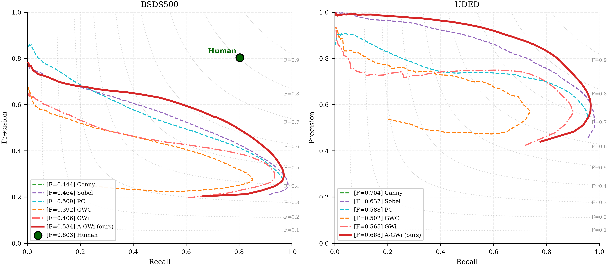
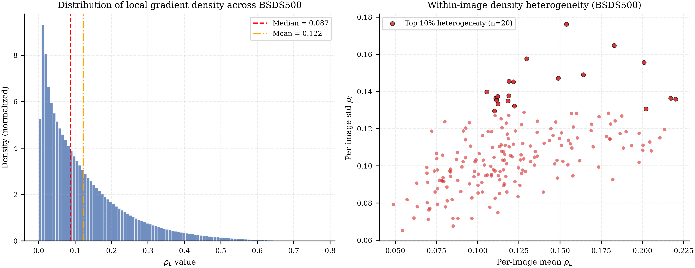

# A-GWi: Adaptive Imaginary Gabor Wavelet for Edge-Based Boundary Detection

> **Pre-review version of Paper 2.** This repository holds the code and results of the manuscript as first submitted to JESA (June 2026), before peer review. The revised and accepted version, with corrected evaluation code, statistics, and ablation, is at **[kukuhyudhistiro/localgradientactivity-](https://github.com/kukuhyudhistiro/localgradientactivity-)**. Cite and reproduce from that repository.
>
> The numbers below are the final values from the revised repository (`results/tables/*.csv`, `results/stats/*.csv`). The values originally produced by this repository are kept further down, marked as superseded.

**Paper status:** accepted at *Journal Européen des Systèmes Automatisés (JESA)* on 15 September 2026, in press.

**Final title:** K. Yudhistiro, R. S. Basuki, and N. Rijati, "Adaptive Imaginary Gabor Wavelet: Per-pixel kernel modulation via local gradient activity for edge-based boundary detection."

---

## Key Results (final, after revision)

A-GWi sets the centre frequency and Gaussian scale of an imaginary-only Gabor kernel at each pixel in closed form from a Sobel-derived local gradient activity estimate (rho_L), without training or GPU.

### ODS / OIS / AP

Berkeley protocol, 99 thresholds, tolerance 0.0075 x image diagonal, dataset-level count accumulation for ODS, OIS, and AP. Canny is evaluated as the Gaussian-smoothed gradient magnitude before non-maximum suppression.

| Method | BSDS500 ODS | BSDS500 OIS | BSDS500 AP | UDED ODS | UDED OIS | UDED AP |
|--------|-------------|-------------|------------|----------|----------|---------|
| Canny (gradient magnitude) | 0.533 | 0.562 | 0.492 | 0.670 | 0.728 | 0.680 |
| Sobel  | 0.464 | 0.503 | 0.405 | 0.637 | 0.713 | 0.647 |
| PC     | 0.524 | 0.542 | 0.417 | 0.568 | 0.619 | 0.432 |
| GWC    | 0.397 | 0.465 | 0.277 | 0.506 | 0.586 | 0.366 |
| GWi    | 0.417 | 0.471 | 0.320 | 0.580 | 0.657 | 0.532 |
| A-GWi  | 0.534 | 0.566 | 0.485 | 0.668 | 0.724 | 0.653 |

BSDS500 bootstrap 95% CI for ODS (2000 resamples over images): A-GWi 0.534 [0.516, 0.553], Canny 0.533 [0.515, 0.552], PC 0.524 [0.508, 0.540], GWi 0.417 [0.399, 0.436], GWC 0.397 [0.378, 0.417].

### Paired tests (BSDS500, n = 200, Wilcoxon on per-image F at ODS threshold)

| Comparison | Median diff | p | Cliff's delta |
|---|---|---|---|
| A-GWi vs GWi | +0.106 | 8.7e-34 | +0.474 |
| A-GWi vs GWC | +0.123 | 3.6e-32 | +0.540 |
| A-GWi vs PC | +0.021 | 1.8e-08 | +0.137 |
| A-GWi vs Sobel | +0.057 | 3.4e-28 | +0.286 |
| A-GWi vs Canny | +0.001 | 0.82 | +0.003 |
| A-GWi vs static kernel at f_min (A12) | -0.001 | 0.35 | -0.004 |

How to read these results:

1. The margin over the two static Gabor baselines (GWi, GWC) is significant on BSDS500 with medium to large effect sizes. This is the controlled comparison, since the three methods share kernel structure, orientation count, window size, and preprocessing.
2. The margin over Canny is **not** significant (p = 0.82), and A-GWi is 265x slower.
3. A static kernel at the lower frequency bound f_min reaches the same accuracy (ODS 0.535 vs 0.534, p = 0.35). At the reported setting, 92.78% of pixels receive a frequency within 1% of f_min, so the gain over static GWi at lambda = 4 comes from the shift in effective centre frequency, not from per-pixel modulation. Forcing the modulation across the full range (A13, CDF mapping) lowers ODS to 0.361.

The per-pixel mechanism therefore acts as automatic operating-point selection; it does not improve on the best static configuration.

### Activity-stratified F-measure

Strata use fixed tertiles of rho_L computed on the BSDS500 training split (t33 = 0.053, t66 = 0.146) and applied as absolute thresholds to both test sets. Predicted and ground-truth pixels outside a stratum are discarded before matching.

| Dataset | Stratum | GT boundary share | GWC | GWi | Canny | A-GWi |
|---------|---------|-------------------|-------|-------|-------|-------|
| BSDS500 | LOW     | 7.1%  | 0.116 | 0.117 | 0.143 | 0.145 |
| BSDS500 | MID     | 25.1% | 0.236 | 0.271 | 0.280 | 0.278 |
| BSDS500 | HIGH    | 67.8% | 0.479 | 0.489 | 0.595 | 0.585 |
| UDED    | LOW     | 9.0%  | 0.149 | 0.139 | 0.215 | 0.218 |
| UDED    | MID     | 28.4% | 0.368 | 0.414 | 0.467 | 0.462 |
| UDED    | HIGH    | 62.6% | 0.650 | 0.719 | 0.768 | 0.743 |

### Runtime (BSDS500, single-threaded, isolated benchmark, ms)

| Method | Mean | Std  | Speed vs A-GWi |
|--------|------|------|----------------|
| Sobel  | 1.66   | 0.08 | 363.5x faster |
| Canny  | 2.28   | 0.10 | 265.4x faster |
| GWi    | 15.54  | 0.55 | 38.9x faster  |
| GWC    | 33.70  | 0.95 | 17.9x faster  |
| PC     | 402.16 | 8.33 | 1.5x faster   |
| A-GWi  | 604.41 | 5.82 | 1.0x (ref)    |

<details>
<summary><b>Superseded: pre-review results produced by this repository (June 2026)</b></summary>

These values were reported in the first submission and are **not** the published results. They are kept so that the submitted version remains reproducible from the code here. Main differences from the revised evaluation:

- Canny did not produce a continuous map that the threshold sweep could traverse like the other methods (AP was not computable). The revision evaluates Canny as the Gaussian-smoothed gradient magnitude before non-maximum suppression, which moves its BSDS500 ODS from 0.444 to 0.533.
- OIS and AP mixed pooled counts with means of per-image values, which does not guarantee a consistent ODS/OIS ordering.
- The revision redefined the strata (fixed rho_L tertiles from the BSDS500 training split, with predictions and ground truth both masked before matching) and added Canny, so the stratified values are not comparable with the revised table.
- Runtime was re-measured in an isolated benchmark run on an idle machine (`benchmark_runtime.py`, 3 repeats).
- The Shannon entropy values in Figure 7 are invalid: `skimage.measure.shannon_entropy` on float arrays counts unique float values and does not measure edge quality. They were removed in the revision.

| Method | BSDS500 ODS | BSDS500 OIS | BSDS500 AP | UDED ODS | UDED OIS | UDED AP |
|--------|-------------|-------------|------------|----------|----------|---------|
| Canny  | 0.444       | 0.470       | -          | 0.704    | 0.683    | -       |
| Sobel  | 0.464       | 0.514       | 0.481      | 0.637    | 0.659    | 0.667   |
| PC     | 0.509       | 0.517       | 0.468      | 0.588    | 0.605    | 0.529   |
| GWC    | 0.392       | 0.455       | 0.303      | 0.502    | 0.536    | 0.360   |
| GWi    | 0.406       | 0.455       | 0.354      | 0.565    | 0.577    | 0.488   |
| A-GWi  | 0.534       | 0.564       | 0.516      | 0.668    | 0.684    | 0.657   |

| Dataset | Stratum | GWC   | GWi   | A-GWi |
|---------|---------|-------|-------|-------|
| BSDS500 | LOW     | 0.156 | 0.193 | 0.214 |
| BSDS500 | MID     | 0.247 | 0.300 | 0.301 |
| BSDS500 | HIGH    | 0.374 | 0.426 | 0.419 |
| UDED    | LOW     | 0.190 | 0.139 | 0.303 |
| UDED    | MID     | 0.334 | 0.399 | 0.418 |
| UDED    | HIGH    | 0.633 | 0.673 | 0.725 |

| Method | Mean (ms) | Std |
|--------|-----------|-----|
| Sobel  | 1.67  | 0.14 |
| Canny  | 1.45  | 0.69 |
| GWi    | 25.55 | 1.38 |
| GWC    | 55.89 | 3.08 |
| PC     | 410   | 6.49 |
| A-GWi  | 633   | 18.4 |

</details>

---

## Figures

Figures below were generated by this repository for the pre-review submission. The final figures are produced by `generate_final_figures.py` in the revised repository.

| | |
|---|---|
|  |  |
| **Figure 3.** Precision-recall curves | **Figure 6.** Local density distribution |

| |
|---|
|  |
| **Figure 4.** Qualitative comparison on BSDS500 |

| |
|---|
|  |
| **Figure 5.** Qualitative comparison on UDED |

| |
|---|
|  |
| **Figure 7.** Dense-object adaptivity (pre-review; the Shannon entropy values shown are invalid, see the superseded results note above) |

---

## Repository Structure

```
agwi/
  README.md
  LICENSE
  requirements.txt
  scripts/
    methods.py                  # 6 edge detectors incl. f0-based A-GWi
    run_experiment.py           # Generate edge maps + runtime.csv
    evaluate.py                 # Berkeley ODS/OIS/AP evaluation
    evaluate_stratified.py      # Density-stratified ODS (LOW/MID/HIGH)
    summarize_runtime.py        # Runtime aggregation for Table 4
    generate_all_figures.py     # ALL paper figures (3-7) in one run
    compare_agwi.py             # Single-image A-GWi comparison + entropy
    make_figures.py             # Density distribution plots
    capture_env.py              # Environment snapshot
  data/
    BSDS500/
      images/test/              # 200 test images (.jpg)
      groundTruth/test/         # 200 ground truth (.mat)
    UDED/
      imgs/                     # 30 images (.jpg)
      gt/                       # 30 ground truth (.png)
  output/                       # Edge maps (generated by run_experiment.py)
  eval_results/                 # ODS/OIS/AP and stratified CSV outputs
  runtime_logs/                 # Per-image runtime CSV
  figures/                      # Paper figures (generated by generate_all_figures.py)
 
```

---

## Installation

```bash
git clone https://github.com/kukuhyudhistiro/agwi.git
cd agwi
pip install -r requirements.txt
```

**Python 3.10+** required. Key dependencies: `numpy`, `opencv-python`, `scipy`, `scikit-image`, `numba`, `matplotlib`, `pandas`, `phasepack`.

Numba is required for A-GWi (provides ~50x speedup via JIT compilation of the per-pixel kernel loop).

---

## Datasets

**BSDS500**: Download from [Berkeley BSDS500](https://www2.eecs.berkeley.edu/Research/Projects/CS/vision/bsds/). Place 200 test images in `data/BSDS500/images/test/` and ground truth `.mat` files in `data/BSDS500/groundTruth/test/`.

**UDED**: Download from the [UDED repository](https://github.com/xavysp/UDED). Place 30 images in `data/UDED/imgs/` and ground truth `.png` files in `data/UDED/gt/`.

---

## Reproduction (pre-review pipeline)

The steps below reproduce the **superseded** pre-review numbers. To reproduce the published numbers, follow the README of [localgradientactivity-](https://github.com/kukuhyudhistiro/localgradientactivity-).

### Quick start (full pipeline)

```bash
# 1. Capture environment
python scripts/capture_env.py --output ./

# 2. Generate edge maps + runtime (~25 min, A-GWi dominates)
python scripts/run_experiment.py --data-root ./data --output-root ./output \
    --datasets BSDS500 UDED --methods AGWi GWi GWC Canny Sobel PC

# 3. Evaluate ODS/OIS/AP (Tables 2, 3)
python scripts/evaluate.py --data-root ./data --output-root ./output \
    --results-dir ./eval_results --datasets BSDS500 UDED \
    --methods AGWi GWi GWC Canny Sobel PC --n-thresholds 99 --max-dist 0.0075

# 4. Density-stratified ODS (Tables 5, 6)
python scripts/evaluate_stratified.py --data-root ./data --output-root ./output \
    --results-dir ./eval_results --datasets BSDS500 UDED \
    --methods AGWi GWi GWC --n-thresholds 99

# 5. Runtime summary (Table 4)
python scripts/summarize_runtime.py --runtime-csv runtime_logs/runtime.csv --dataset BSDS500

# 6. Generate ALL paper figures (Figures 3-7)
python scripts/generate_all_figures.py --data-root ./data --output-root ./output \
    --eval-results ./eval_results --figures-dir ./figures
```

### Script-to-paper element map

| Paper Element | Script | Output |
|---|---|---|
| Table 2 (BSDS500 ODS/OIS/AP) | `evaluate.py` | `eval_results/ods_summary.csv` |
| Table 3 (UDED ODS/OIS/AP) | `evaluate.py` | `eval_results/ods_summary.csv` |
| Table 4 (runtime) | `summarize_runtime.py` | terminal output |
| Table 5 (BSDS500 stratified) | `evaluate_stratified.py` | `eval_results/ods_stratified.csv` |
| Table 6 (UDED stratified) | `evaluate_stratified.py` | `eval_results/ods_stratified.csv` |
| Figure 3 (PR curves) | `generate_all_figures.py` | `figures/fig3_pr_curves.png` |
| Figure 4 (BSDS500 qualitative) | `generate_all_figures.py` | `figures/fig4_qualitative_BSDS500.png` |
| Figure 5 (UDED qualitative) | `generate_all_figures.py` | `figures/fig5_qualitative_UDED.png` |
| Figure 6 (density distribution) | `generate_all_figures.py` | `figures/fig6_density_distribution.png` |
| Figure 7 (dense-object comparison) | `generate_all_figures.py` | `figures/fig7_dense_object_comparison.png` |

### Hardware and threading

All experiments are single-threaded: `OMP_NUM_THREADS=1`, `MKL_NUM_THREADS=1`, `NUMBA_NUM_THREADS=1`, `cv2.setNumThreads(1)`. A Numba warm-up pass is performed before timing to exclude JIT compilation cost.

Reported results: Intel Core i5-14400, 16 GB DDR4, Windows 11.

---

## A-GWi Algorithm

A-GWi has six stages:

1. **Preprocessing**: BT.601 grayscale, histogram equalization, normalization to [0,1]
2. **Density estimation**: Sobel gradient energy (ksize=5) + GaussianBlur(5x5) to produce rho_L
3. **Adaptive parameters**: f0, sigma, k computed per pixel from rho_L via sigmoid mapping
4. **Kernel construction**: Per-pixel imaginary (sine) Gabor kernel for N=8 orientations
5. **Spatially varying convolution**: Unique kernel at each pixel, each orientation
6. **Magnitude extraction**: Cross-orientation max-pooling of absolute response

Fixed parameters:
```
f_min=0.05  f_max=0.45  k_steepness=25.0  orientations=8  gamma=0.5
kernel_size=7  sigma=(1/(pi*f0))*sqrt(ln2/2)
```

Dense regions (high rho_L) get high-frequency, compact kernels for sharp boundary localization.
Sparse regions (low rho_L) get low-frequency, broad kernels for large-scale structure.

---

## Evaluation Protocol

Berkeley protocol following [Arbelaez et al., TPAMI 2011]:
- 99 uniformly spaced thresholds in [0.01, 0.99]
- Morphological thinning (skimage.morphology.thin)
- Greedy bipartite matching via KDTree
- Tolerance: 0.0075 x image diagonal
- Metrics: ODS, OIS, AP
- Multi-annotator matching for BSDS500

---

## Citation

Please cite the accepted article and use the revised repository for reproduction:

```bibtex
@article{yudhistiro2026agwi,
  title   = {Adaptive Imaginary {G}abor Wavelet: Per-pixel kernel modulation
             via local gradient activity for edge-based boundary detection},
  author  = {Yudhistiro, Kukuh and Basuki, Ruri Suko and Rijati, Nova},
  journal = {Journal Europ{\'e}en des Syst{\`e}mes Automatis{\'e}s (JESA)},
  year    = {2026},
  note    = {Accepted 15 September 2026, in press. Code: https://github.com/kukuhyudhistiro/localgradientactivity-}
}
```

## Related Work

- **A-GWi, revised and accepted version** (Paper 2): [github.com/kukuhyudhistiro/localgradientactivity-](https://github.com/kukuhyudhistiro/localgradientactivity-)
- **GWi+ODPS** (Paper 1): [github.com/kukuhyudhistiro/gwi-odps](https://github.com/kukuhyudhistiro/gwi-odps)
  Imaginary-only Gabor wavelet with orientation-aware double-peak suppression, under review at Digital Signal Processing (manuscript DSP-D-26-02462).

---

## License

This project is licensed under the MIT License. See [LICENSE](LICENSE) for details.

## Author Contributions

Conceptualization, K. Yudhistiro, R.S. Basuki, and N. Rijati; methodology and software, K. Yudhistiro; validation, all authors; formal analysis, data curation, and visualization, K. Yudhistiro; writing (original draft), K. Yudhistiro; writing (review and editing), R.S. Basuki and N. Rijati; supervision, R.S. Basuki and N. Rijati.
